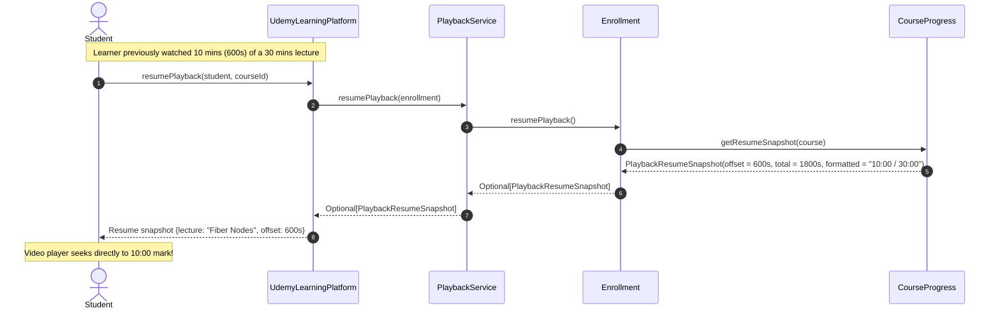
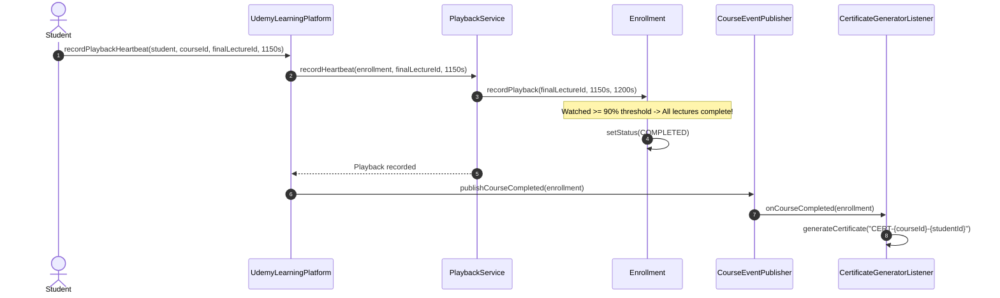

# Enterprise Online Learning Platform (Udemy) — Low-Level Design Specification

A production-grade, extensible Low-Level Design (LLD) and machine coding architecture for an enterprise online learning, video streaming, and course management platform.

---

## 1. Domain Decomposition & Architecture

```
                                  ┌───────────────────────────┐
                                  │   UdemyLearningPlatform   │
                                  └─────────────┬─────────────┘
                                                │
         ┌────────────────────────┬─────────────┴─────────────┬────────────────────────┐
         ▼                        ▼                           ▼                        ▼
┌─────────────────┐      ┌─────────────────┐         ┌─────────────────┐      ┌─────────────────┐
│CourseCatalogSvc │      │EnrollmentService│         │ PlaybackService │      │  ReviewService  │
│Course & Modules │      │Idempotent Enroll│         │Heartbeats&Resume│      │Verified Ratings │
└─────────────────┘      └─────────────────┘         └─────────────────┘      └─────────────────┘
```

---

## 2. Master UML Class Diagram

```mermaid
classDiagram
    direction TB

    %% Enumerations
    class CourseStatus {
        <<enumeration>>
        DRAFT
        SUBMITTED_FOR_REVIEW
        PUBLISHED
        ARCHIVED
    }

    class ResourceType {
        <<enumeration>>
        VIDEO
        FILE_ATTACHMENT
        READING_LINK
    }

    class EnrollmentStatus {
        <<enumeration>>
        ACTIVE
        COMPLETED
        REFUNDED
        SUSPENDED
    }

    class AuthorshipRole {
        <<enumeration>>
        LEAD_INSTRUCTOR
        CO_INSTRUCTOR
        TEACHING_ASSISTANT
    }

    %% Base Entities & Value Objects
    class BaseEntity {
        <<abstract>>
        #String id
        #LocalDateTime createdAt
        #LocalDateTime updatedAt
        +getId() String
        +getCreatedAt() LocalDateTime
        +getUpdatedAt() LocalDateTime
        +markUpdated() void
    }

    class User {
        <<abstract>>
        #String email
        #String fullName
        #String profilePictureUrl
        +getEmail() String
        +getFullName() String
    }

    class Instructor {
        -String biography
        -String expertiseArea
        -List~CourseAuthorship~ authorships
        +addAuthorship(CourseAuthorship authorship) void
        +getAuthorships() List~CourseAuthorship~
    }

    class Student {
        -List~String~ enrolledCourseIds
        +addEnrolledCourse(String courseId) void
        +isEnrolled(String courseId) boolean
    }

    class CourseAuthorship {
        -String courseId
        -Instructor instructor
        -AuthorshipRole role
        -double revenueSharePercentage
        +getInstructor() Instructor
        +getRole() AuthorshipRole
        +getRevenueSharePercentage() double
    }

    %% Course Composite & Catalog
    class CourseComponent {
        <<interface>>
        +getId() String
        +getTitle() String
        +getDurationSeconds() int
        +getLectureCount() int
    }

    class Course {
        -String title
        -String description
        -double basePrice
        -CourseStatus status
        -List~CourseAuthorship~ authorships
        -List~Module~ modules
        -List~Review~ reviews
        -double averageRating
        -int totalRatingsCount
        +publish() void
        +archive() void
        +addModule(Module module) void
        +addAuthorship(CourseAuthorship authorship) void
        +addReview(Review review) void
        +getDurationSeconds() int
        +getLectureCount() int
        +getAverageRating() double
    }

    class Module {
        -String title
        -int orderIndex
        -List~Lecture~ lectures
        +addLecture(Lecture lecture) void
        +getLectures() List~Lecture~
        +getDurationSeconds() int
        +getLectureCount() int
    }

    class Lecture {
        -String title
        -int orderIndex
        -VideoContent video
        -List~LectureResource~ resources
        +setVideo(VideoContent video) void
        +addResource(LectureResource resource) void
        +getDurationSeconds() int
        +getLectureCount() int
    }

    %% Media & Resources
    class VideoContent {
        -String videoUrl
        -int durationSeconds
        -String previewThumbnailUrl
        -Map~String, String~ streamingResolutions
        +getVideoUrl() String
        +getDurationSeconds() int
        +addStreamingResolution(String res, String url) void
    }

    class LectureResource {
        <<abstract>>
        #String title
        #ResourceType resourceType
        +getTitle() String
        +getResourceType() ResourceType
    }

    class FileAttachment {
        -String fileUrl
        -long fileSizeBytes
        -String fileExtension
        +getFileUrl() String
        +getFileSizeBytes() long
        +getFileExtension() String
    }

    class ReadingLink {
        -String targetUrl
        -String description
        +getTargetUrl() String
        +getDescription() String
    }

    %% Progress & Resumable Playback
    class Enrollment {
        -Student student
        -Course course
        -EnrollmentStatus status
        -LocalDateTime enrolledAt
        -LocalDateTime completedAt
        -CourseProgress progress
        -CompletionCriteriaStrategy completionStrategy
        +recordPlayback(String lectureId, int currentSeconds, int totalDurationSeconds) void
        +resumePlayback() Optional~PlaybackResumeSnapshot~
        +isCompleted() boolean
    }

    class CourseProgress {
        -String enrollmentId
        -String lastAccessedLectureId
        -Map~String, LectureProgress~ lectureProgressMap
        +recordPlayback(String lectureId, int currentSeconds, int totalDurationSeconds, CompletionCriteriaStrategy strategy) void
        +getCompletedLectureCount() int
        +getCompletionPercentage(int totalLectures) double
        +isCourseCompleted(int totalLectures) boolean
        +getResumeSnapshot(Course course) Optional~PlaybackResumeSnapshot~
    }

    class LectureProgress {
        -String lectureId
        -int lastWatchedPositionSeconds
        -int maxWatchedPositionSeconds
        -boolean completed
        -LocalDateTime lastAccessedAt
        +updatePosition(int currentSeconds, int totalDurationSeconds, CompletionCriteriaStrategy strategy) void
        +markCompleted() void
        +getLastWatchedPositionSeconds() int
        +isCompleted() boolean
    }

    class PlaybackResumeSnapshot {
        -String courseId
        -String moduleId
        -String lectureId
        -String lectureTitle
        -int resumePositionSeconds
        -int totalDurationSeconds
        +getFormattedResumeTime() String
        +getResumePositionSeconds() int
        +getTotalDurationSeconds() int
    }

    %% Reviews
    class Review {
        -Student student
        -String courseId
        -double rating
        -String feedbackComment
        +getStudent() Student
        +getRating() double
        +getFeedbackComment() String
    }

    %% Strategies & Events
    class CompletionCriteriaStrategy {
        <<interface>>
        +isLectureCompleted(int lastSec, int maxSec, int totalDuration) boolean
    }

    class PercentageThresholdCompletionStrategy {
        -double thresholdPercentage
        +isLectureCompleted(int lastSec, int maxSec, int totalDuration) boolean
    }

    class CourseEventPublisher {
        -List~CourseEventListener~ listeners
        +subscribe(CourseEventListener listener) void
        +publishCourseCompleted(Enrollment enrollment) void
    }

    class CourseEventListener {
        <<interface>>
        +onCourseCompleted(Enrollment enrollment) void
    }

    class CertificateGeneratorListener {
        -List~String~ generatedCertificates
        +onCourseCompleted(Enrollment enrollment) void
        +hasCertificate(String studentId, String courseId) boolean
    }

    %% Facade
    class UdemyLearningPlatform {
        -CourseCatalogService catalogService
        -EnrollmentService enrollmentService
        -PlaybackService playbackService
        -ReviewService reviewService
        -CourseEventPublisher eventPublisher
        +registerCourse(Course course) void
        +publishCourse(String courseId) void
        +enroll(Student student, String courseId) Enrollment
        +recordPlaybackHeartbeat(Student student, String courseId, String lectureId, int timestamp) void
        +resumePlayback(Student student, String courseId) Optional~PlaybackResumeSnapshot~
        +rateCourse(Student student, String courseId, double rating, String comment) Review
    }

    %% Relationships
    BaseEntity <|-- User
    BaseEntity <|-- CourseAuthorship
    BaseEntity <|-- Course
    BaseEntity <|-- Module
    BaseEntity <|-- Lecture
    BaseEntity <|-- LectureResource
    BaseEntity <|-- Enrollment
    BaseEntity <|-- Review

    User <|-- Instructor
    User <|-- Student

    CourseComponent <|.. Course
    CourseComponent <|.. Module
    CourseComponent <|.. Lecture

    Course "1" *-- "1..*" Module : contains ordered
    Module "1" *-- "1..*" Lecture : contains ordered
    Lecture "1" *-- "1" VideoContent : primary video
    Lecture "1" *-- "0..*" LectureResource : attachments

    LectureResource <|-- FileAttachment
    LectureResource <|-- ReadingLink

    Course "1" *-- "1..*" CourseAuthorship : co-authored through
    Instructor "1" *-- "0..*" CourseAuthorship : participates in

    Student "1" o-- "0..*" Enrollment : enrolls
    Course "1" o-- "0..*" Enrollment : enrolled students
    Enrollment "1" *-- "1" CourseProgress : manages
    CourseProgress "1" *-- "0..*" LectureProgress : per lecture
    CourseProgress ..> PlaybackResumeSnapshot : generates

    Course "1" *-- "0..*" Review : receives
    Student "1" --> "0..*" Review : authors

    CompletionCriteriaStrategy <|.. PercentageThresholdCompletionStrategy
    Enrollment --> CompletionCriteriaStrategy

    CourseEventPublisher o-- "0..*" CourseEventListener
    CourseEventListener <|.. CertificateGeneratorListener
    Enrollment ..> CourseEventPublisher : triggers completion

    UdemyLearningPlatform --> CourseCatalogService
    UdemyLearningPlatform --> EnrollmentService
    UdemyLearningPlatform --> PlaybackService
    UdemyLearningPlatform --> ReviewService
    UdemyLearningPlatform --> CourseEventPublisher
```



---

## 3. Sequence Diagrams

### 3.1 Resuming Video Playback Workflow



### 3.2 Asynchronous Completion & Certification Workflow


