# Enterprise Online Learning Platform (Udemy) — Master Design Specification

A comprehensive, production-grade Low-Level Design (LLD) and machine coding architecture for an enterprise online learning, video streaming, and course management platform.

---

## 1. Domain Decomposition & Architecture

```
                                  ┌───────────────────────────┐
                                  │   UdemyLearningPlatform   │ (Facade)
                                  └─────────────┬─────────────┘
                                                │
         ┌────────────────────────┬─────────────┴─────────────┬────────────────────────┐
         ▼                        ▼                           ▼                        ▼
┌─────────────────┐      ┌─────────────────┐         ┌─────────────────┐      ┌─────────────────┐
│CourseCatalogSvc │      │EnrollmentService│         │ PlaybackService │      │  ReviewService  │
│  - State Pattern│      │  - State Guard  │         │  - Heartbeats   │      │  - Verified Only│
│  - Chain Audit  │      │  - Idempotent   │         │  - Resume Snap  │      │  - Clamped Stars│
│  - CDN Adapter  │      │    Enrollment   │         │  - 90% Threshold│      │  - Moving Avg   │
└─────────────────┘      └─────────────────┘         └─────────────────┘      └─────────────────┘
```

---

## 2. Design Pattern Catalog

| Pattern | Category | Concrete Implementation | Architectural Motivation |
| :--- | :--- | :--- | :--- |
| **Composite** | Structural | `CourseComponent` $\to$ `Course`, `Module`, `Lecture` | Uniform duration rollup and lecture counts across the curriculum tree. |
| **State** | Behavioral | `CourseState` (`DraftCourseState`, `PublishedCourseState`, `ArchivedCourseState`) | Governs lifecycle transitions; rejects student enrollment in draft/archived states; locks curriculum modifications when published. |
| **Chain of Responsibility** | Behavioral | `CoursePublishingValidator` (`InstructorValidator` $\to$ `CurriculumCompletenessValidator` $\to$ `VideoQualityValidator`) | Enforces modular, fail-fast publishing audits (100% revenue share, non-empty curriculum, valid video duration) before a course goes live. |
| **Adapter** | Structural | `CdnStreamAdapter` (`AwsCloudFrontAdapter`, `CloudflareStreamAdapter`) | Bridges vendor-specific signed streaming token APIs (CloudFront Key-Pair signed URLs vs Cloudflare HMAC HLS manifests) to a uniform internal streaming interface. |
| **Builder** | Creational | `CourseBuilder`, `ModuleBuilder`, `LectureBuilder` | Provides a fluent, type-safe DSL to assemble 3-tier course hierarchies with nested lectures, videos, and multi-instructor splits. |
| **Strategy** | Behavioral | `CompletionCriteriaStrategy` (90% auto-complete threshold), `PricingStrategy` (Standard, Promotional Tier) | Pluggable algorithms for video completion thresholds and dynamic discounting. |
| **Observer** | Behavioral | `CourseEventPublisher` $\to$ `CertificateGeneratorListener` | Asynchronously generates student completion certificates upon 100% course completion without coupling playback code. |
| **Facade** | Structural | `UdemyLearningPlatform` | Unified entry point coordinating catalog, playback, enrollment, and ratings. |

---

## 3. Master UML Class Diagram

```mermaid
classDiagram
    direction TB

    %% Enumerations
    class CourseStatus {
        <<enumeration>>
        DRAFT
        PUBLISHED
        ARCHIVED
    }

    class ResourceType {
        <<enumeration>>
        VIDEO
        FILE_ATTACHMENT
        READING_LINK
    }

    class EnrollmentStatus {
        <<enumeration>>
        ACTIVE
        COMPLETED
        REFUNDED
        SUSPENDED
    }

    class AuthorshipRole {
        <<enumeration>>
        LEAD_INSTRUCTOR
        CO_INSTRUCTOR
        TEACHING_ASSISTANT
    }

    %% Base Entities & Value Objects
    class BaseEntity {
        <<abstract>>
        #String id
        #LocalDateTime createdAt
        #LocalDateTime updatedAt
        +getId() String
        +getCreatedAt() LocalDateTime
        +getUpdatedAt() LocalDateTime
        +markUpdated() void
    }

    class User {
        <<abstract>>
        #String email
        #String fullName
        #String profilePictureUrl
        +getEmail() String
        +getFullName() String
    }

    class Instructor {
        -String biography
        -String expertiseArea
        -List~CourseAuthorship~ authorships
        +addAuthorship(CourseAuthorship authorship) void
        +getAuthorships() List~CourseAuthorship~
    }

    class Student {
        -List~String~ enrolledCourseIds
        +addEnrolledCourse(String courseId) void
        +isEnrolled(String courseId) boolean
    }

    class CourseAuthorship {
        -String courseId
        -Instructor instructor
        -AuthorshipRole role
        -double revenueSharePercentage
        +getInstructor() Instructor
        +getRole() AuthorshipRole
        +getRevenueSharePercentage() double
    }

    %% State Pattern
    class CourseState {
        <<interface>>
        +addModule(Course course, Module module) void
        +publish(Course course) void
        +archive(Course course) void
        +enrollStudent(Course course, Student student) void
        +getStatus() CourseStatus
    }

    class DraftCourseState {
        +addModule(Course course, Module module) void
        +publish(Course course) void
        +archive(Course course) void
        +enrollStudent(Course course, Student student) void
        +getStatus() CourseStatus
    }

    class PublishedCourseState {
        +addModule(Course course, Module module) void
        +publish(Course course) void
        +archive(Course course) void
        +enrollStudent(Course course, Student student) void
        +getStatus() CourseStatus
    }

    class ArchivedCourseState {
        +addModule(Course course, Module module) void
        +publish(Course course) void
        +archive(Course course) void
        +enrollStudent(Course course, Student student) void
        +getStatus() CourseStatus
    }

    CourseState <|.. DraftCourseState
    CourseState <|.. PublishedCourseState
    CourseState <|.. ArchivedCourseState

    %% Chain of Responsibility
    class CoursePublishingValidator {
        <<interface>>
        +setNext(CoursePublishingValidator next) void
        +validate(Course course) void
    }

    class AbstractCoursePublishingValidator {
        <<abstract>>
        #CoursePublishingValidator next
        +setNext(CoursePublishingValidator next) void
        #passToNext(Course course) void
    }

    class InstructorValidator {
        +validate(Course course) void
    }

    class CurriculumCompletenessValidator {
        +validate(Course course) void
    }

    class VideoQualityValidator {
        +validate(Course course) void
    }

    class CourseValidationPipeline {
        -CoursePublishingValidator headValidator
        +validate(Course course) void
    }

    CoursePublishingValidator <|.. AbstractCoursePublishingValidator
    AbstractCoursePublishingValidator <|-- InstructorValidator
    AbstractCoursePublishingValidator <|-- CurriculumCompletenessValidator
    AbstractCoursePublishingValidator <|-- VideoQualityValidator
    CourseValidationPipeline o-- CoursePublishingValidator

    %% CDN Adapter Pattern
    class CdnStreamAdapter {
        <<interface>>
        +generateSecureStreamUrl(String path, String studentId, int expirySeconds) String
        +getProviderName() String
    }

    class AwsCloudFrontAdapter {
        -AwsCloudFrontClient cloudFrontClient
        +generateSecureStreamUrl(String path, String studentId, int expirySeconds) String
        +getProviderName() String
    }

    class CloudflareStreamAdapter {
        -CloudflareStreamClient cloudflareClient
        +generateSecureStreamUrl(String path, String studentId, int expirySeconds) String
        +getProviderName() String
    }

    CdnStreamAdapter <|.. AwsCloudFrontAdapter
    CdnStreamAdapter <|.. CloudflareStreamAdapter

    %% Course Composite & Catalog
    class CourseComponent {
        <<interface>>
        +getId() String
        +getTitle() String
        +getDurationSeconds() int
        +getLectureCount() int
    }

    class Course {
        -String title
        -String description
        -double basePrice
        -CourseState state
        -CourseValidationPipeline validationPipeline
        -CdnStreamAdapter cdnAdapter
        -List~CourseAuthorship~ authorships
        -List~Module~ modules
        -List~Review~ reviews
        -double averageRating
        -int totalRatingsCount
        +publish() void
        +archive() void
        +enroll(Student student) void
        +addModule(Module module) void
        +generateStreamUrl(Lecture lecture, Student student, int expirySeconds) String
        +getDurationSeconds() int
        +getLectureCount() int
        +getAverageRating() double
    }

    class Module {
        -String title
        -int orderIndex
        -List~Lecture~ lectures
        +addLecture(Lecture lecture) void
        +getLectures() List~Lecture~
        +getDurationSeconds() int
        +getLectureCount() int
    }

    class Lecture {
        -String title
        -int orderIndex
        -VideoContent video
        -List~LectureResource~ resources
        +setVideo(VideoContent video) void
        +addResource(LectureResource resource) void
        +getDurationSeconds() int
        +getLectureCount() int
    }

    CourseComponent <|.. Course
    CourseComponent <|.. Module
    CourseComponent <|.. Lecture

    Course "1" *-- "1..*" Module : contains ordered
    Module "1" *-- "1..*" Lecture : contains ordered
    Course "1" o-- "1" CourseState : delegates lifecycle
    Course "1" o-- "1" CourseValidationPipeline : audit before publish
    Course "1" o-- "0..1" CdnStreamAdapter : streaming provider
    Course "1" *-- "1..*" CourseAuthorship : co-authored through

    %% Builder Pattern
    class CourseBuilder {
        +create(String title, String desc, double price)$ CourseBuilder
        +withLeadInstructor(Instructor inst, double share) CourseBuilder
        +withCoInstructor(Instructor inst, double share) CourseBuilder
        +withCdnAdapter(CdnStreamAdapter adapter) CourseBuilder
        +addModule(String title, Consumer~ModuleBuilder~ cfg) CourseBuilder
        +build() Course
    }

    CourseBuilder ..> Course : builds
```



---

## 4. Key Sequence Flows

### 4.1 Course Publishing Pipeline with Chain of Responsibility & State Pattern

```mermaid
sequenceDiagram
    autonumber
    actor Instructor
    participant Course as Course Aggregate
    participant State as DraftCourseState
    participant Pipeline as CourseValidationPipeline
    participant InstVal as InstructorValidator
    participant CurrVal as CurriculumCompletenessValidator
    participant VideoVal as VideoQualityValidator
    participant PubState as PublishedCourseState

    Instructor ->> Course: publish()
    Course ->> State: publish(course)
    State ->> Pipeline: validate(course)
    Pipeline ->> InstVal: validate(course)
    Note over InstVal: Verifies >=1 instructor & 100% revenue share
    InstVal ->> CurrVal: validate(course)
    Note over CurrVal: Verifies non-empty modules & lectures
    CurrVal ->> VideoVal: validate(course)
    Note over VideoVal: Verifies video content & duration > 0
    VideoVal -->> State: Validation Passed!
    State ->> Course: setState(new PublishedCourseState())
    Note over Course: Status is now PUBLISHED; enrollments enabled!
```

### 4.2 Resumable Playback with Drop-off Tracking


