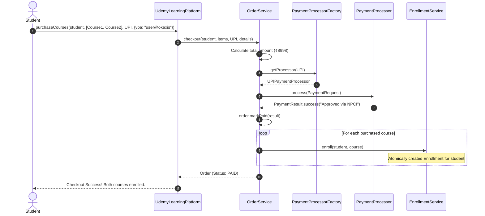
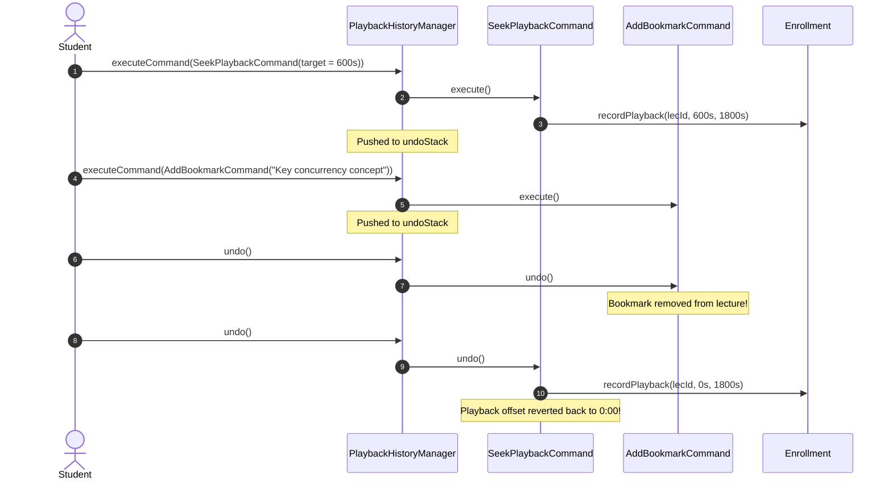

# Enterprise Online Learning Platform (Udemy) — Master Design Specification

A comprehensive, production-grade Low-Level Design (LLD) and machine coding architecture for an enterprise online learning, video streaming, multi-course checkout, and resumable playback platform.

---

## 1. High-Level Domain Decomposition

```
                                  ┌───────────────────────────┐
                                  │   UdemyLearningPlatform   │ (Facade)
                                  └─────────────┬─────────────┘
                                                │
         ┌────────────────────────┬─────────────┴─────────────┬────────────────────────┐
         ▼                        ▼                           ▼                        ▼
┌─────────────────┐      ┌─────────────────┐         ┌─────────────────┐      ┌─────────────────┐
│CourseCatalogSvc │      │  OrderService   │         │ PlaybackService │      │  ReviewService  │
│  - State Pattern│      │  - Multi-Course │         │  - Command Ptr  │      │  - Verified Only│
│  - Chain Audit  │      │  - Payment SPI  │         │  - Heartbeats   │      │  - Clamped Stars│
│  - CDN Adapter  │      │  - Decorator Add│         │  - Resume Snap  │      │  - Moving Avg   │
│  - Builder DSL  │      │  - Auto-Enroll  │         │  - 90% Threshold│      │                 │
└─────────────────┘      └─────────────────┘         └─────────────────┘      └─────────────────┘
```

---

## 2. Complete Design Pattern Catalog

| Pattern | Category | Concrete Implementation | Architectural Motivation |
| :--- | :--- | :--- | :--- |
| **Composite** | Structural | `CourseComponent` $\to$ `Course`, `Module`, `Lecture` | Uniform duration rollup and lecture counts across the curriculum tree. |
| **State** | Behavioral | `CourseState` (`DraftCourseState`, `PublishedCourseState`, `ArchivedCourseState`) | Governs lifecycle transitions; rejects student enrollment in draft/archived states; locks curriculum modifications when published. |
| **Chain of Responsibility** | Behavioral | `CoursePublishingValidator` (`InstructorValidator` $\to$ `CurriculumCompletenessValidator` $\to$ `VideoQualityValidator`) | Enforces modular, fail-fast publishing audits (100% revenue share, non-empty curriculum, valid video duration) before a course goes live. |
| **Adapter** | Structural | `CdnStreamAdapter` (`AwsCloudFrontAdapter`, `CloudflareStreamAdapter`) | Bridges vendor-specific signed streaming token APIs (CloudFront Key-Pair signed URLs vs Cloudflare HMAC HLS manifests) to a uniform internal streaming interface. |
| **Builder** | Creational | `CourseBuilder`, `ModuleBuilder`, `LectureBuilder` | Provides a fluent, type-safe DSL to assemble 3-tier course hierarchies with nested lectures, videos, and multi-instructor splits. |
| **Decorator** | Structural | `CourseAddonDecorator` (`VerifiedCertificateAddon`, `MentorshipDoubtSupportAddon`, `OfflineDownloadAddon`) | Dynamically bundles optional value-added services onto courses without subclass explosion. |
| **Command** | Behavioral | `PlaybackCommand` (`SeekPlaybackCommand`, `AddBookmarkCommand`, `ToggleLectureCompleteCommand`) | Encapsulates user playback interactions with undo stack and audit log history. |
| **Factory / Registry** | Creational | `PaymentProcessorFactory` | Decoupled registry mapping `PaymentMethod` to concrete `PaymentProcessor` implementations. |
| **Strategy** | Behavioral | `PaymentProcessor` SPI, `CompletionCriteriaStrategy` (90% threshold), `PricingStrategy` (Standard, Promo) | Pluggable algorithms for financial settlement, video auto-completion, and dynamic discounting. |
| **Observer** | Behavioral | `CourseEventPublisher` $\to$ `CertificateGeneratorListener` | Asynchronously generates student completion certificates upon 100% course completion without coupling playback code. |
| **Facade** | Structural | `UdemyLearningPlatform` | Unified entry point coordinating catalog, playback, multi-course checkout, and ratings. |

---

## 3. Master UML Class Diagram

```mermaid
classDiagram
    direction TB

    %% Enumerations
    class CourseStatus {
        <<enumeration>>
        DRAFT
        PUBLISHED
        ARCHIVED
    }

    class PaymentMethod {
        <<enumeration>>
        CREDIT_CARD
        UPI
        PAYPAL
    }

    class OrderStatus {
        <<enumeration>>
        CREATED
        PAID
        FAILED
        CANCELLED
    }

    class AuthorshipRole {
        <<enumeration>>
        LEAD_INSTRUCTOR
        CO_INSTRUCTOR
        TEACHING_ASSISTANT
    }

    %% Base Entities & Value Objects
    class BaseEntity {
        <<abstract>>
        #String id
        #LocalDateTime createdAt
        #LocalDateTime updatedAt
        +getId() String
        +getCreatedAt() LocalDateTime
        +getUpdatedAt() LocalDateTime
        +markUpdated() void
    }

    class User {
        <<abstract>>
        #String email
        #String fullName
        +getEmail() String
        +getFullName() String
    }

    class Instructor {
        -String expertiseArea
        -List~CourseAuthorship~ authorships
        +addAuthorship(CourseAuthorship authorship) void
    }

    class Student {
        -List~String~ enrolledCourseIds
        +addEnrolledCourse(String courseId) void
        +isEnrolled(String courseId) boolean
    }

    class CourseAuthorship {
        -String courseId
        -Instructor instructor
        -AuthorshipRole role
        -double revenueSharePercentage
        +getInstructor() Instructor
        +getRole() AuthorshipRole
        +getRevenueSharePercentage() double
    }

    %% State Pattern
    class CourseState {
        <<interface>>
        +addModule(Course course, Module module) void
        +publish(Course course) void
        +archive(Course course) void
        +enrollStudent(Course course, Student student) void
        +getStatus() CourseStatus
    }

    class DraftCourseState {
        +addModule(Course course, Module module) void
        +publish(Course course) void
        +archive(Course course) void
        +enrollStudent(Course course, Student student) void
        +getStatus() CourseStatus
    }

    class PublishedCourseState {
        +addModule(Course course, Module module) void
        +publish(Course course) void
        +archive(Course course) void
        +enrollStudent(Course course, Student student) void
        +getStatus() CourseStatus
    }

    class ArchivedCourseState {
        +addModule(Course course, Module module) void
        +publish(Course course) void
        +archive(Course course) void
        +enrollStudent(Course course, Student student) void
        +getStatus() CourseStatus
    }

    CourseState <|.. DraftCourseState
    CourseState <|.. PublishedCourseState
    CourseState <|.. ArchivedCourseState

    %% Chain of Responsibility
    class CoursePublishingValidator {
        <<interface>>
        +setNext(CoursePublishingValidator next) void
        +validate(Course course) void
    }

    class AbstractCoursePublishingValidator {
        <<abstract>>
        #CoursePublishingValidator next
        +setNext(CoursePublishingValidator next) void
        #passToNext(Course course) void
    }

    class InstructorValidator {
        +validate(Course course) void
    }

    class CurriculumCompletenessValidator {
        +validate(Course course) void
    }

    class VideoQualityValidator {
        +validate(Course course) void
    }

    class CourseValidationPipeline {
        -CoursePublishingValidator headValidator
        +validate(Course course) void
    }

    CoursePublishingValidator <|.. AbstractCoursePublishingValidator
    AbstractCoursePublishingValidator <|-- InstructorValidator
    AbstractCoursePublishingValidator <|-- CurriculumCompletenessValidator
    AbstractCoursePublishingValidator <|-- VideoQualityValidator
    CourseValidationPipeline o-- CoursePublishingValidator

    %% CDN Adapter Pattern
    class CdnStreamAdapter {
        <<interface>>
        +generateSecureStreamUrl(String path, String studentId, int expirySeconds) String
        +getProviderName() String
    }

    class AwsCloudFrontAdapter {
        -AwsCloudFrontClient cloudFrontClient
        +generateSecureStreamUrl(String path, String studentId, int expirySeconds) String
        +getProviderName() String
    }

    class CloudflareStreamAdapter {
        -CloudflareStreamClient cloudflareClient
        +generateSecureStreamUrl(String path, String studentId, int expirySeconds) String
        +getProviderName() String
    }

    CdnStreamAdapter <|.. AwsCloudFrontAdapter
    CdnStreamAdapter <|.. CloudflareStreamAdapter

    %% Course Composite & Catalog
    class CourseComponent {
        <<interface>>
        +getId() String
        +getTitle() String
        +getDurationSeconds() int
        +getLectureCount() int
    }

    class Course {
        -String title
        -String description
        -double basePrice
        -CourseState state
        -CourseValidationPipeline validationPipeline
        -CdnStreamAdapter cdnAdapter
        -List~CourseAuthorship~ authorships
        -List~Module~ modules
        -List~Review~ reviews
        -double averageRating
        -int totalRatingsCount
        +publish() void
        +archive() void
        +enroll(Student student) void
        +addModule(Module module) void
        +generateStreamUrl(Lecture lecture, Student student, int expirySeconds) String
        +getDurationSeconds() int
        +getLectureCount() int
        +getAverageRating() double
    }

    class Module {
        -String title
        -int orderIndex
        -List~Lecture~ lectures
        +addLecture(Lecture lecture) void
        +getLectures() List~Lecture~
        +getDurationSeconds() int
        +getLectureCount() int
    }

    class Lecture {
        -String title
        -int orderIndex
        -VideoContent video
        -List~LectureResource~ resources
        +setVideo(VideoContent video) void
        +addResource(LectureResource resource) void
        +getDurationSeconds() int
        +getLectureCount() int
    }

    CourseComponent <|.. Course
    CourseComponent <|.. Module
    CourseComponent <|.. Lecture

    Course "1" *-- "1..*" Module : contains ordered
    Module "1" *-- "1..*" Lecture : contains ordered
    Course "1" o-- "1" CourseState : delegates lifecycle
    Course "1" o-- "1" CourseValidationPipeline : audit before publish
    Course "1" o-- "0..1" CdnStreamAdapter : streaming provider
    Course "1" *-- "1..*" CourseAuthorship : co-authored through

    %% Decorator Pattern for Addons
    class CourseProduct {
        <<interface>>
        +getCourse() Course
        +getDescription() String
        +getPrice() double
        +getEntitlements() List~String~
    }

    class BaseCourseProduct {
        -Course course
        +getPrice() double
        +getEntitlements() List~String~
    }

    class CourseAddonDecorator {
        <<abstract>>
        #CourseProduct wrappedProduct
        +getCourse() Course
    }

    class VerifiedCertificateAddon {
        +getPrice() double
        +getEntitlements() List~String~
    }

    class MentorshipDoubtSupportAddon {
        +getPrice() double
        +getEntitlements() List~String~
    }

    class OfflineDownloadAddon {
        +getPrice() double
        +getEntitlements() List~String~
    }

    CourseProduct <|.. BaseCourseProduct
    CourseProduct <|.. CourseAddonDecorator
    CourseAddonDecorator <|-- VerifiedCertificateAddon
    CourseAddonDecorator <|-- MentorshipDoubtSupportAddon
    CourseAddonDecorator <|-- OfflineDownloadAddon

    %% Command Pattern for Playback
    class PlaybackCommand {
        <<interface>>
        +execute() void
        +undo() void
        +getDescription() String
    }

    class SeekPlaybackCommand {
        -Enrollment enrollment
        -String lectureId
        -int targetSeconds
        -int previousSeconds
        +execute() void
        +undo() void
    }

    class AddBookmarkCommand {
        -List~Bookmark~ bookmarkList
        -Bookmark bookmark
        +execute() void
        +undo() void
    }

    class PlaybackHistoryManager {
        -Deque~PlaybackCommand~ undoStack
        -List~String~ executionAuditLog
        +executeCommand(PlaybackCommand command) void
        +undo() boolean
    }

    PlaybackCommand <|.. SeekPlaybackCommand
    PlaybackCommand <|.. AddBookmarkCommand
    PlaybackHistoryManager o-- PlaybackCommand

    %% Multi-Course Order & Payment SPI
    class PaymentProcessor {
        <<interface>>
        +process(PaymentRequest request) PaymentResult
        +getSupportedMethod() PaymentMethod
    }

    class PaymentProcessorFactory {
        -Map~PaymentMethod, PaymentProcessor~ registry
        +register(PaymentProcessor processor) void
        +getProcessor(PaymentMethod method) PaymentProcessor
    }

    class Order {
        -Student student
        -List~OrderItem~ items
        -double totalAmount
        -OrderStatus status
        -PaymentResult paymentResult
        +addItem(OrderItem item) void
        +markPaid(PaymentResult result) void
        +markFailed(PaymentResult result) void
    }

    class OrderService {
        -PaymentProcessorFactory paymentProcessorFactory
        -EnrollmentService enrollmentService
        +checkout(Student s, List~OrderItem~ items, PaymentMethod m, Map details) Order
    }

    OrderService o-- PaymentProcessorFactory
    OrderService o-- Order
    PaymentProcessorFactory o-- PaymentProcessor
```



---

## 4. Key Sequence Workflows

### 4.1 Multi-Course Checkout & Automatic Enrollment



### 4.2 Playback Seek & Bookmark with Command Undo


